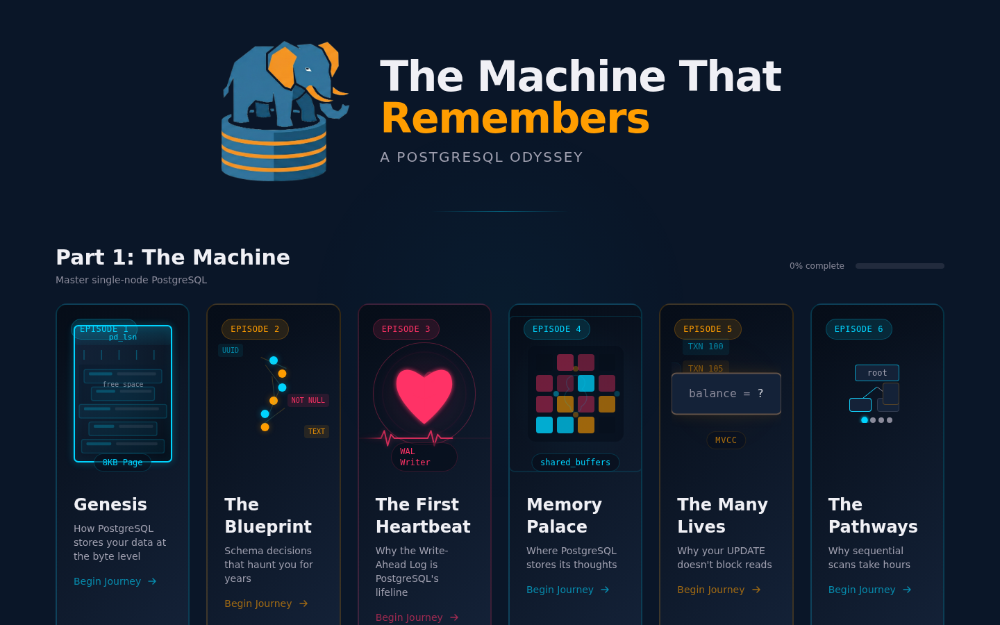
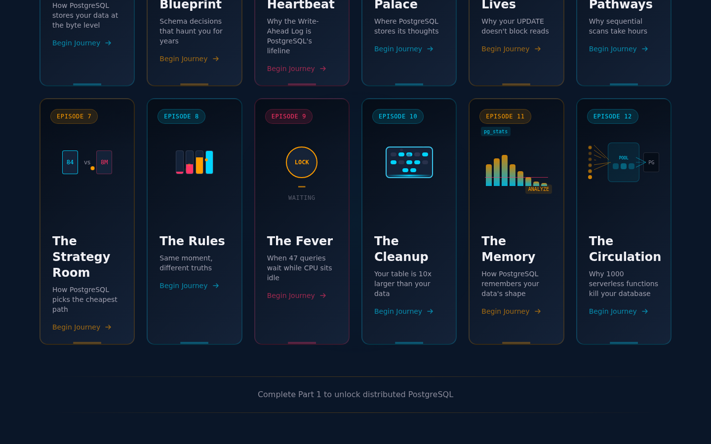

# PostgreSQL Odyssey — The Machine That Remembers

[](./LICENSE)
[](https://postgres-odyssey.vercel.app)
[](https://github.com/charles161/postgres-odyssey/actions/workflows/ci.yml)

An **interactive 15-episode visual journey through PostgreSQL internals** — paired with a hands-on multi-node Docker lab and deep-dive engineering guides covering everything from 8KB heap pages and MVCC to WAL, B-trees, locks, VACUUM, replication, partitioning, and sharding.

Explore it live at **[postgres-odyssey.vercel.app](https://postgres-odyssey.vercel.app)**.

<p align="center">
  
</p>

## The 15 Interactive Episodes

### Part 1: The Machine *(Single-Node PostgreSQL)*

| # | Episode | What you explore interactively |
| --- | --- | --- |
| 1 | **Genesis** | 8KB heap pages, `pd_lsn`, line pointers, and tuple layout at the byte level |
| 2 | **The Blueprint** | Data types, byte alignment, padding waste, and schema decisions that stick for years |
| 3 | **The First Heartbeat** | Write-Ahead Log (WAL), crash recovery, and why durability stays fast |
| 4 | **Memory Palace** | `shared_buffers`, OS page cache, dirty pages, and clock-sweep eviction |
| 5 | **The Many Lives** | MVCC, `xmin`/`xmax` tuple chains, snapshots, and why writers don't block readers |
| 6 | **The Pathways** | Sequential scans vs B-tree navigation, index anatomy, and heap fetches |
| 7 | **The Strategy Room** | Query planner cost model, join algorithms, and `EXPLAIN ANALYZE` |
| 8 | **The Rules** | Isolation levels, visibility rules, and race conditions |
| 9 | **The Fever** | Lock types, lock queues, `ALTER TABLE` pileups, and deadlock sandboxes |
| 10 | **The Cleanup** | Dead tuples, table bloat, `VACUUM`, visibility maps, and XID wraparound |
| 11 | **The Memory** | Planner statistics, histograms, `ANALYZE`, and stale-stats plan flips |
| 12 | **The Circulation** | Connection overhead, serverless storms, and PgBouncer transaction pooling |

### Part 2: The Fleet *(Scaling Beyond One Machine)*

| # | Episode | What you explore interactively |
| --- | --- | --- |
| 13 | **Cell Division** | Streaming WAL replication, read replicas, and replication lag |
| 14 | **Organ Specialization** | Declarative partitioning, partition pruning, and write scaling |
| 15 | **Beyond the Machine** | Sharding, shard keys, consistent hashing, and distributed tradeoffs |

<p align="center">
  
</p>

## Quick Start

### 1. Run the Interactive Web App

```bash
git clone https://github.com/charles161/postgres-odyssey.git
cd postgres-odyssey/app
npm install
npm run dev
```

### 2. Spin Up the Multi-Node Postgres 16 Lab (Optional)

Includes a primary Postgres 16 node (with `wal_level=logical` and `pg_stat_statements`), a replica node, and pgAdmin for running the SQL exercises locally:

```bash
cd docker
docker compose up -d

# Connect to primary
docker exec -it postgres-primary psql -U postgres -d learn
```

## Repository Layout

```text
postgres-odyssey/
├── app/                     # React + TypeScript + Vite interactive 15-episode visual app
├── masterclass/             # 9-stage deep-dive written curriculum (storage -> distributed)
├── curriculum/              # Structured 15-day hands-on path with SQL exercises & solutions
├── exercises/               # Standalone query optimization exercises
├── cheatsheets/             # Quick-reference operator & SQL cheatsheets
├── diagrams/                # Architecture & replication ASCII/Mermaid diagrams
├── storytelling-frameworks/ # Visual metaphor & narrative design notes
└── docker/                  # Local multi-node Postgres 16 + pgAdmin lab
```

## Tech Stack

- **Interactive App (`app/`):** React 19, TypeScript, Vite, Tailwind CSS, Framer Motion, GSAP
- **Local Lab (`docker/`):** PostgreSQL 16 (primary + replica) + pgAdmin

## License

[MIT](./LICENSE)
